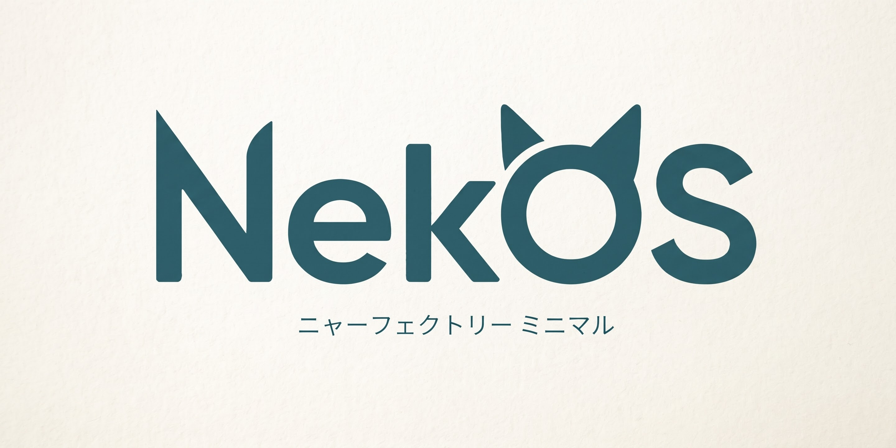
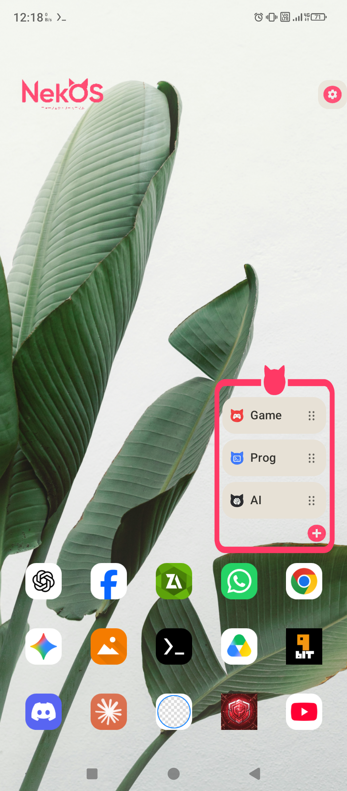
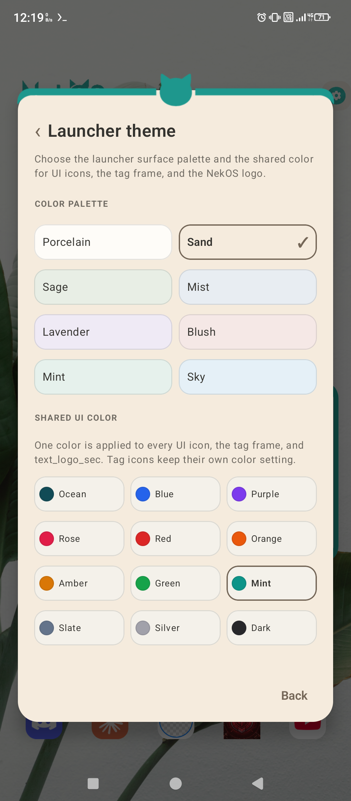
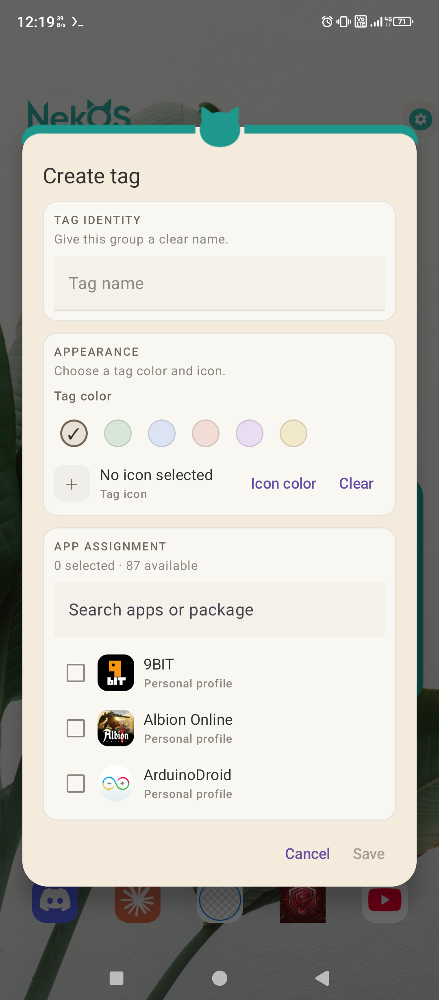

# NekOS

<p align="center">
  
</p>

<p align="center">
  <em>ニャーフェクトリー ミニマル</em>
</p>

<p align="center">
  <em>A cozy space for your everyday apps.</em>
</p>

NekOS is a simple Android launcher with a cozy-tech, cat-themed look. It brings everyday apps together through a small Favorite Grid, colorful Tag groups, and a searchable App Drawer—without turning the Home Screen into a complicated dashboard.

The goal is simple: **make your apps comfortable to find, organize, and open.**

## Screenshots

The following screenshots show the NekOS 0.6.1 interface.

<p align="center">
  
  
  
</p>
<p align="center">
  
  
  
</p>

## Features

- **Favorite Grid** — 15 slots arranged in a 5 × 3 grid. Keep frequently used apps on Home.
- **Tag Rail** — create, rename, reorder, and delete app groups. Choose a color and an optional icon, then assign installed apps to each tag.
- **App Drawer** — browse launchable apps with their original Android icons.
- **App Search** — find apps by any part of their name, without case sensitivity.
- **App Actions** — open App info, add or remove favorites, and request uninstall through Android's system interface.
- **Personal appearance** — choose a built-in Home background or use a custom wallpaper.
- **Multi-profile awareness** — app entries are identified by app and Android profile, helping keep work or other profiles distinct.

For implementation-level details and current limitations, see the [Feature Inventory](docs/FEATURE_INVENTORY.md).

## How it works

| Area | Interaction |
| --- | --- |
| Open an app | Tap its icon |
| Open app actions | Long-press an app |
| Rearrange favorites | Long-press, then drag |
| Open the App Drawer | Swipe up from the Home canvas or Favorite area |
| Search apps | Type in the App Drawer search field |
| Open a Tag | Tap the Tag |
| Manage a Tag | Use its handle to open Tag actions |
| Return to Home | Close the drawer or press the Android Home button |

## Design philosophy

NekOS intentionally favors a focused everyday experience:

- **Simple:** only keep features that help with everyday app access.
- **Comfortable:** warm, calm colors and rounded surfaces.
- **Personal:** arrange favorites, tags, and the Home appearance.
- **Predictable:** familiar Android interactions and system UI for sensitive actions.
- **Stable:** reliability comes before adding more features.

NekOS is not intended to become a feature-heavy launcher. It deliberately avoids a widget engine, nested folders, multiple Home pages, news feeds, complex automation, and an elaborate theme system. Read [Product Direction](docs/PRODUCT_DIRECTION.md) for the design boundaries.

## Project status

- **Version:** 0.6.1
- **Application ID:** `com.nekos.android`
- **Platform:** Android 8.0 (API 26) and newer
- **Target SDK:** 35
- **Status:** in active development; not yet a stable production release
- **Latest release notes:** [NekOS 0.6.1](docs/releases/v0.6.1.md)

The feature list describes what is implemented in the source on `main`; it does not mean every interaction has been verified on every Android device. Physical-device checks and stability improvements remain part of development.

## Build

### Android Studio

1. Clone or download this repository.
2. Open the project in Android Studio.
3. Allow Gradle sync to finish.
4. Run the `app` configuration on an Android device or emulator.

The project uses Kotlin, Jetpack Compose, Android Gradle Plugin, and Java 17. This repository does not currently include a Gradle Wrapper.

### Termux

Termux builds may need a local AAPT2 override. Keep this machine-specific setting in `$HOME/.gradle/gradle.properties`, not in the repository:

```properties
android.aapt2FromMavenOverride=/data/data/com.termux/files/usr/bin/aapt2
```

Adjust the path only if AAPT2 is installed elsewhere. See [Building NekOS](docs/BUILDING.md) for additional notes.

## Repository map

- `app/` — Android application source and resources.
- `main_assets/branding/` — logos, concept artwork, and project visuals.
- `main_assets/icons/app/` — 100 application-style icons and their index.
- `main_assets/icons/ui/` — 120 interface icons and their index.
- `main_assets/dynamic/` — animated UI artwork and frame assets.
- `user_screenshot/` — screenshots used in this README.
- `docs/FEATURE_INVENTORY.md` — implementation status and known gaps.
- `docs/PRODUCT_DIRECTION.md` — product goals and intentionally excluded features.
- `docs/BUILDING.md` — build environment notes.
- `THIRD_PARTY_NOTICES.md` — third-party software attributions and license details.

## License

NekOS is released under the [MIT License](LICENSE). Third-party dependencies retain their respective licenses; see [Third-Party Notices](THIRD_PARTY_NOTICES.md).

## Support

To keep the fuel running this little car,
I need a little Ko-fi. 😁
You can support me on ☕[Ko-fi](https://ko-fi.com/mazbayid)
