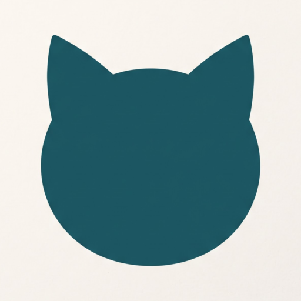

  

# NekOS

A calm, customizable Android launcher.

## MVP

- Clean home screen with a minimal tag placeholder and a 5 × 3 favorite-slot layout.
- Swipe up to open the installed-app drawer.
- App drawer uses a five-column grid and native Android application icons.
- Tap an app to launch it.
- Swipe down to return to the home screen.

## Android project

- Application ID / namespace: `com.nekos.android`
- Kotlin + Jetpack Compose
- Launcher icon copied from `main_assets/app_logo.png` to `app/src/main/res/drawable-nodpi/app_logo.png`

## Build

Open this repository in Android Studio, sync Gradle, and run the `app` module on an Android device or emulator.

This first MVP intentionally leaves tag management, favorites assignment, persistence, and settings for subsequent steps.
