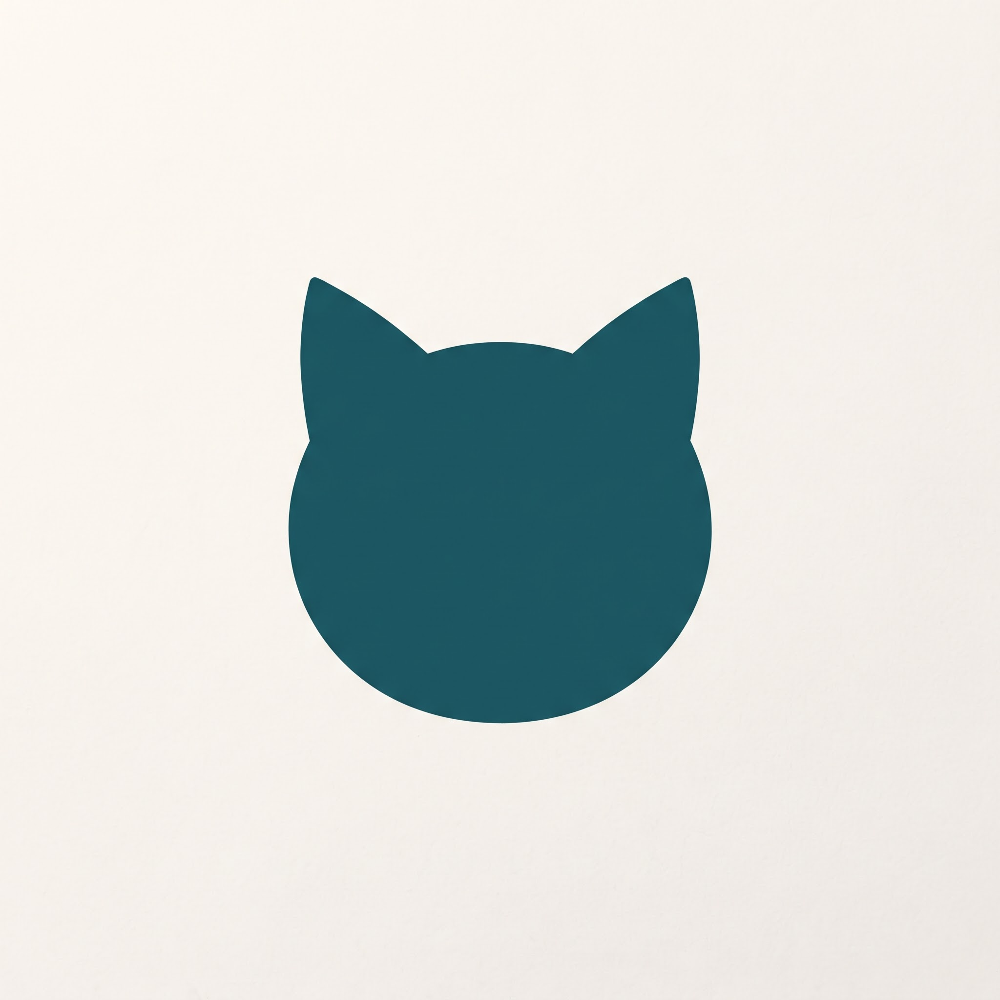
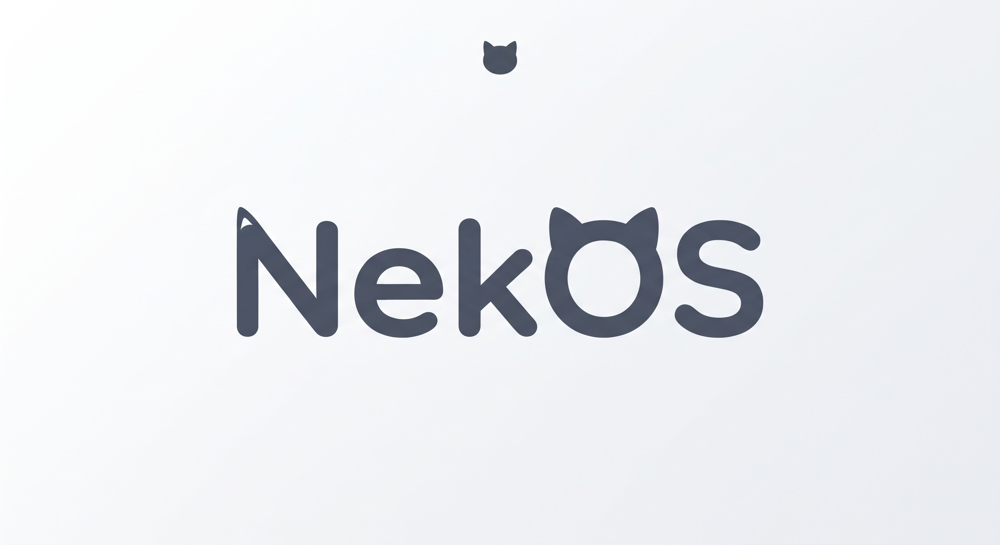
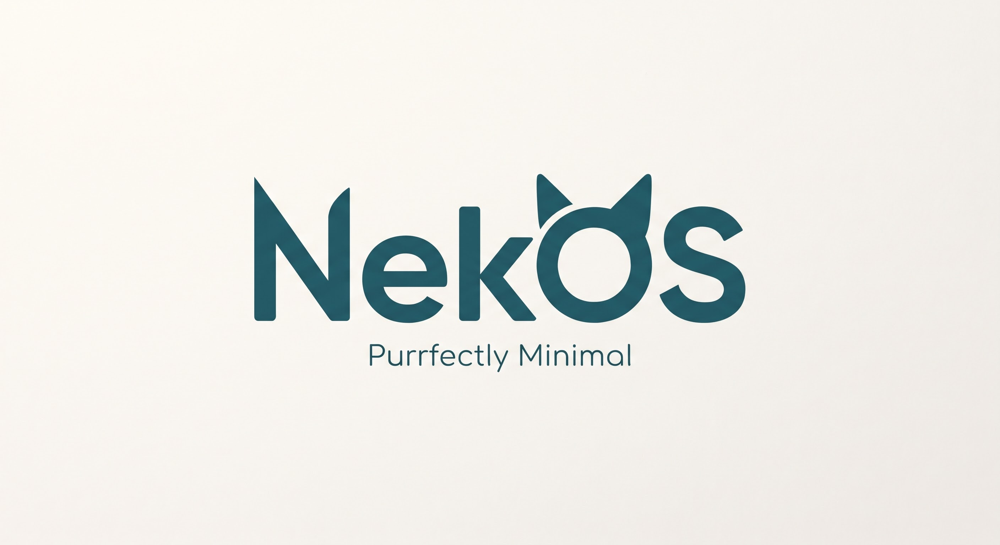
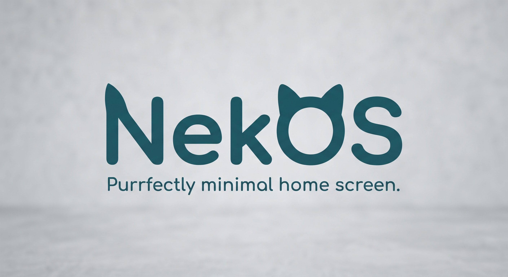

<h1>
  
  NekOS
</h1>

  

  
  

This project was inspired by my headache of searching
and sorting the applications I have based on my needs.

And also thanks to my disgust with the default android launcher
and android launchers on the market which are complicated and annoying.
