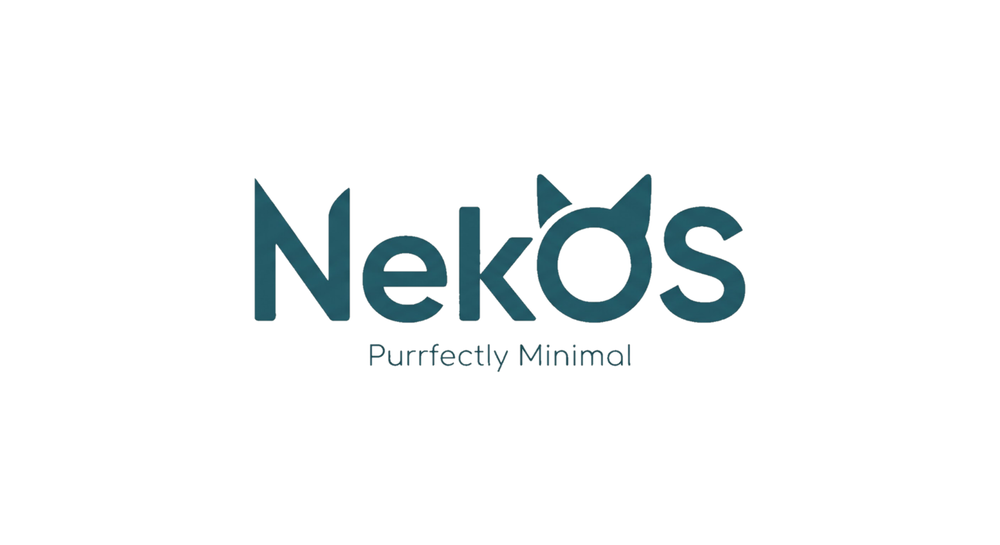
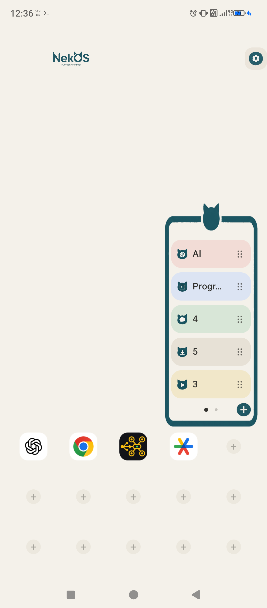
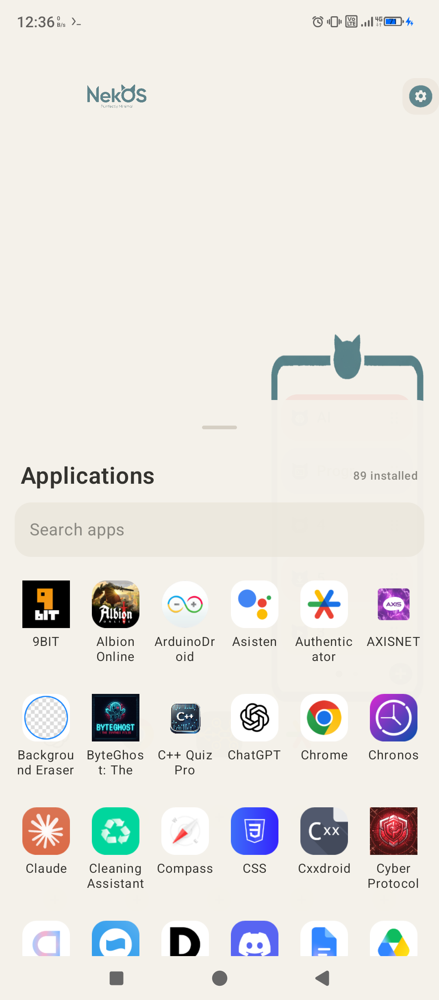
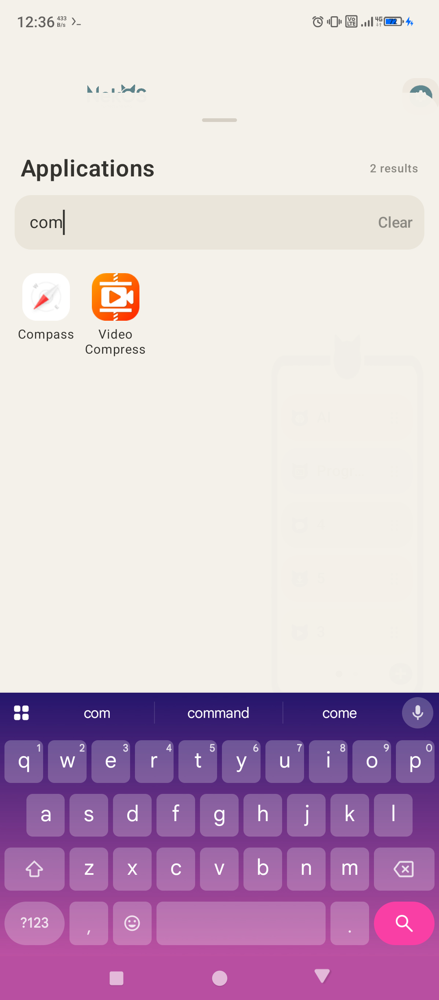

# NekOS v0.1.0 — Initial Public Preview

  

<em>A cozy space for your everyday apps.</em>

## What is NekOS?

NekOS is a lightweight Android launcher with a cozy-tech, cat-themed visual identity. It is designed to make everyday apps comfortable to find, organize, and open. Instead of turning the Home Screen into a complex dashboard, NekOS keeps the experience focused on a few useful areas: favorites, app groups, and a searchable app drawer.

## Screenshots

### Home Screen

The Home Screen combines a 5 × 3 Favorite Grid with the Tag Rail on the right, keeping frequently used apps and app groups within reach.

### App Drawer

Swipe up to browse installed apps and access the app list.

### App Search

Search by app name to find an installed app without scrolling through the full list.

## Highlights

- **Favorite Grid:** 15 slots arranged in a 5 × 3 grid for frequently used apps.
- **Tag Rail:** organize apps into up to 10 color-customizable groups, with five tags shown per page.
- **App Drawer:** browse launchable apps with their original Android icons.
- **App Search:** filter apps by name as you type, without case sensitivity.
- **Personal appearance:** choose built-in Home backgrounds or use a custom wallpaper.
- **App actions:** access supported app-management actions through Android system interfaces.
- **Set as Home:** request NekOS as the device's default launcher.

## Compatibility

- Minimum Android version: Android 8.0 (API 26).
- Application ID: `com.nekos.android`.

## Release notes

This is NekOS's first public preview, distributed as an APK through GitHub Releases. It is not a Google Play release. Layout and behavior may vary across devices and Android versions; feedback and reproducible bug reports are welcome through the repository issue tracker.

**Warning: NekOS launcher is already usable, but it is still under active development.**
