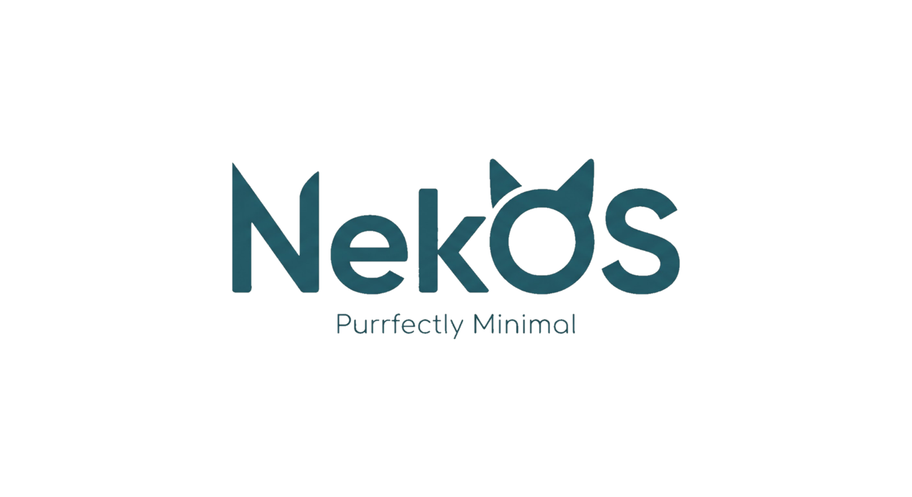
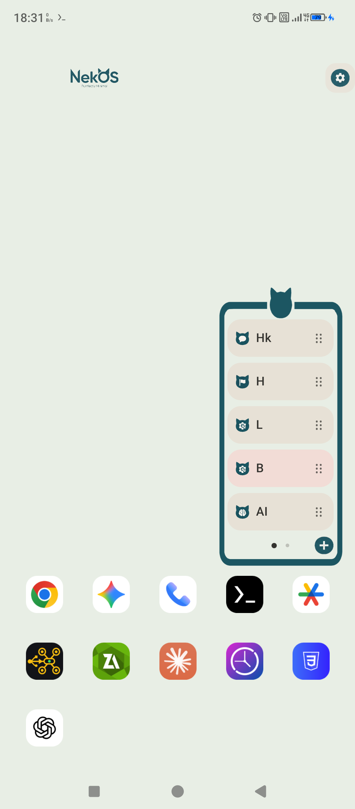
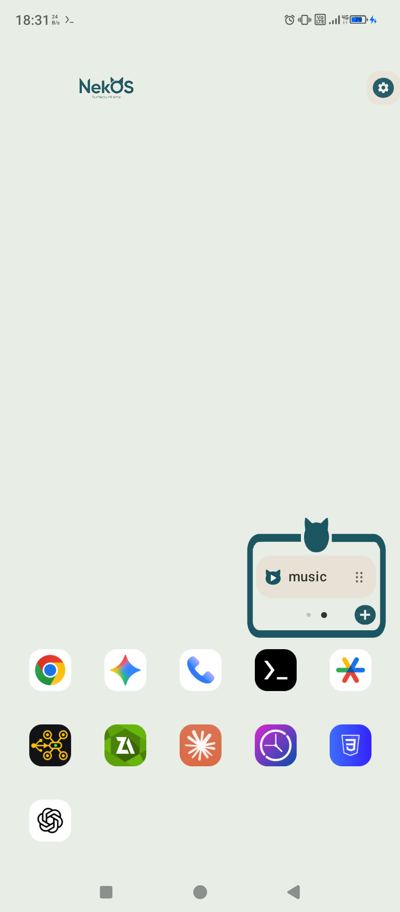
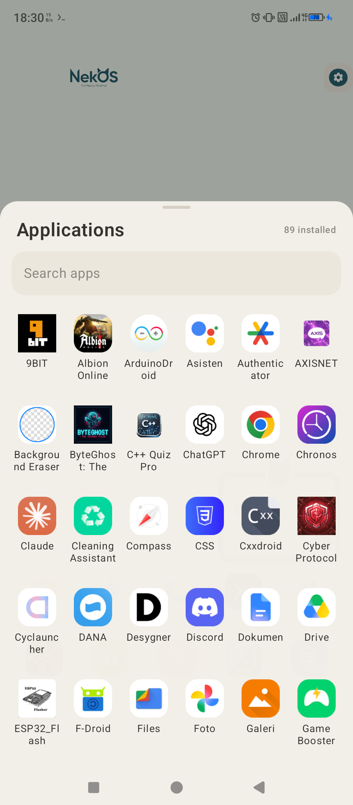

# NekOS v0.1.1 — Performance & Usability Update

  

<em>A cozy space for your everyday apps.</em>

## Highlights

- **Faster app icon access:** added adaptive RAM caching and background preloading for the installed app catalog.
- **Persistent icon cache:** reuse processed icons from disk to reduce repeated decoding and conversion.
- **Improved foreground recovery:** refresh visible icon references when NekOS returns from the background.
- **Favorite management:** remove an app from Favorites through its app action menu without uninstalling it.
- **Clearer uninstall action:** the uninstall icon is now red to distinguish this destructive action.
- **Launcher refinements:** continued stability and usability improvements to the Home Screen and App Drawer.

## Screenshots

### Home Screen

### App Drawer

## Compatibility

- Minimum Android version: Android 8.0 (API 26).
- Application ID: `com.nekos.android`.

## Installation

Download `app-release.apk` from the Assets section below and install it on your Android device.

NekOS is distributed as an APK through GitHub Releases. It is not a Google Play release and remains under active development.

**Warning: NekOS launcher is already usable, but it is still under active development.**

