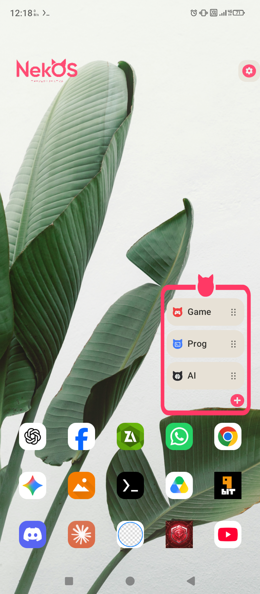
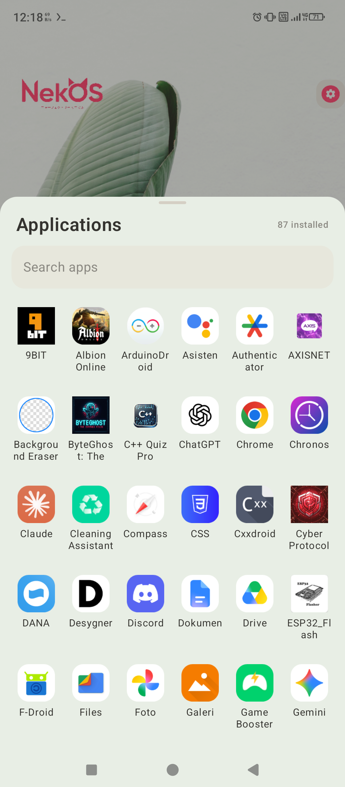
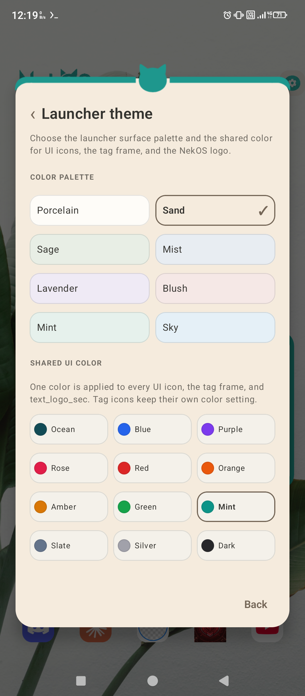
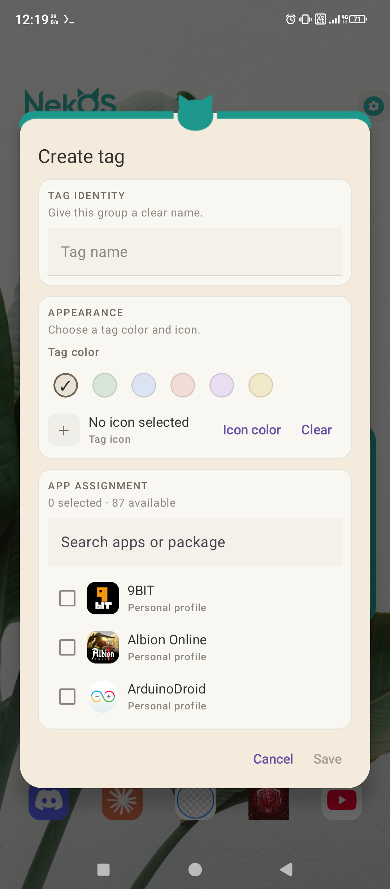
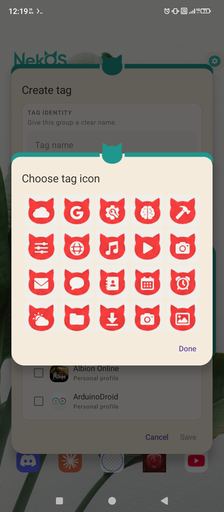

# NekOS 0.6.1

NekOS 0.6.1 focuses on a more consistent dialog experience and a clearer way to organize tags and launcher settings.

> **Development notice:** NekOS is still under active development. This release is not a guarantee of production stability. You may encounter bugs, incomplete behavior, or changes in future versions. Please use it with that in mind and report any issues you find.

## What's new

### A clearer Add Tag experience
- Reorganized the tag editor into three focused sections: **Tag Identity**, **Appearance**, and **App Assignment**.
- Made the editing flow easier to scan while keeping the existing tag options and app assignment controls.
- Restored the assigned-app list and corrected the dialog structure.

### More organized Launcher Settings
- Refined the settings layout with grouped sections and cards.
- Improved spacing and visual hierarchy so related options are easier to distinguish.

### Dialog visual polish
- Consolidated dialog presentation around the shared NekOS dialog frame.
- Refined title layout and typography for a more consistent appearance across dialogs.
- Adjusted the top frame sizing and alignment.

## Screenshots

The following screenshots show NekOS 0.6.1:

  
  
  

  
  
  

## Version information

- **Version name:** 0.6.1
- **Android version code:** 3
- **Application ID:** `com.nekos.android`
- **Minimum Android version:** Android 8.0 (API 26)

## Upgrade notes

Install this version over an existing NekOS installation only when the APK is signed with the same signing key as the installed build. Keep your signing key safe; Android requires the same signing identity for in-place updates.

---

NekOS is an evolving project. Thank you for testing it and helping improve it.
