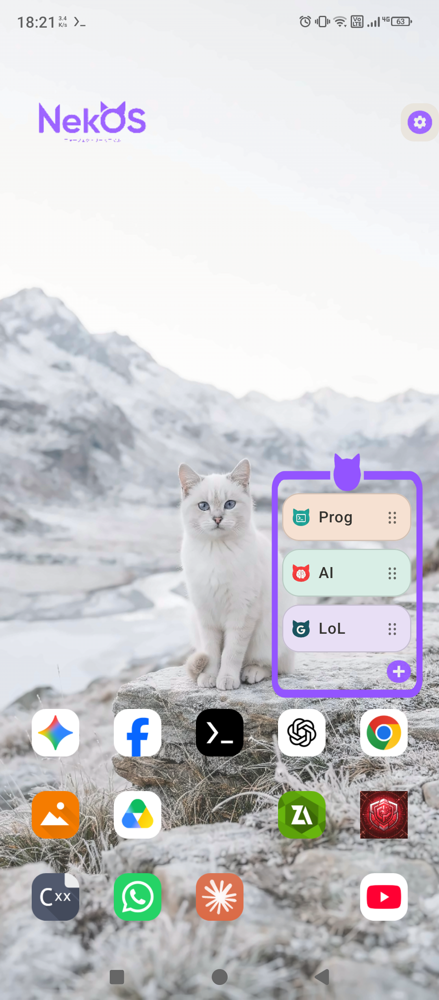
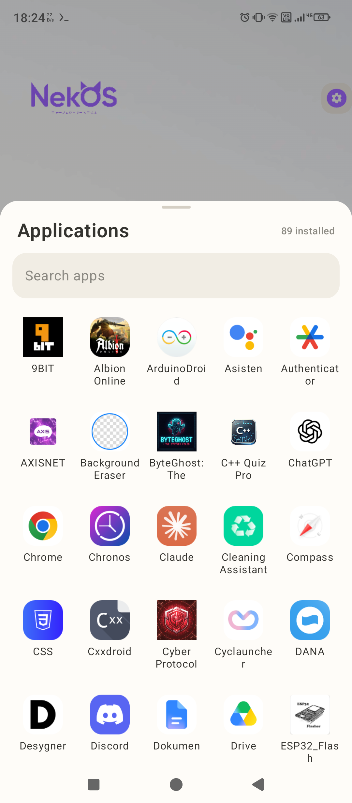
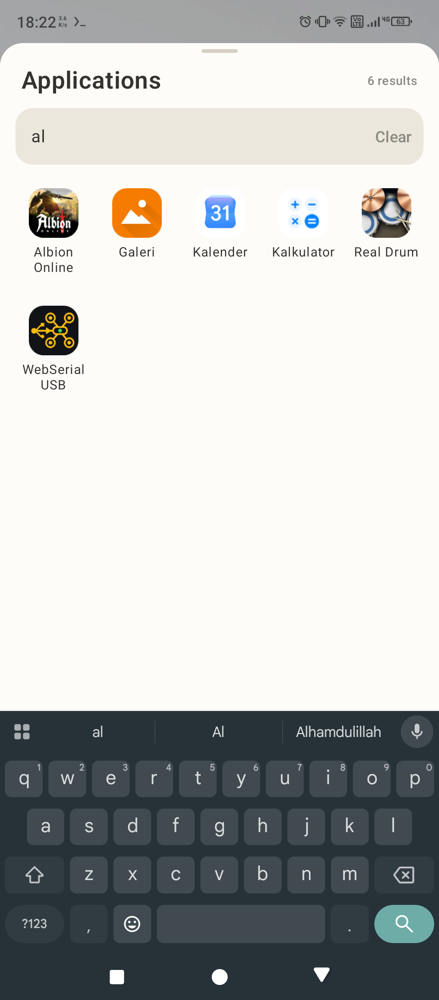
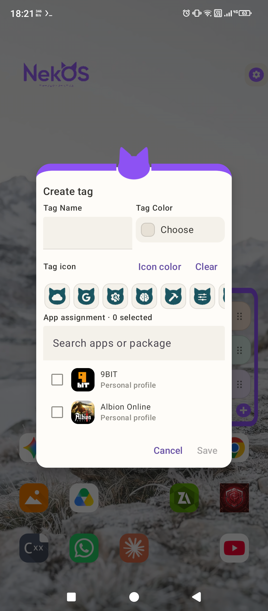
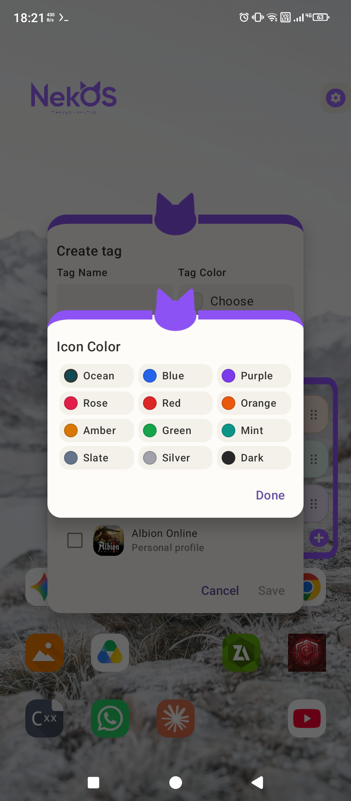
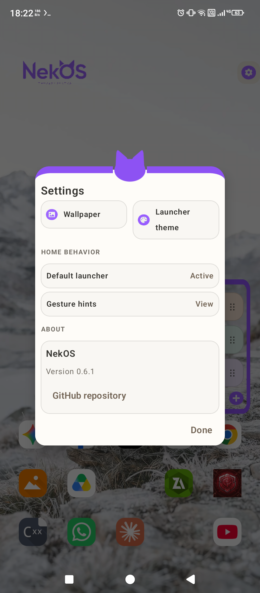
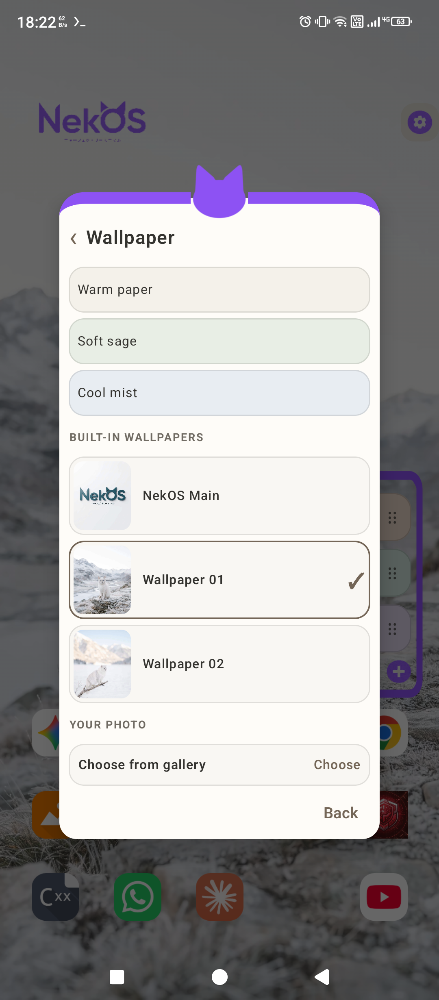
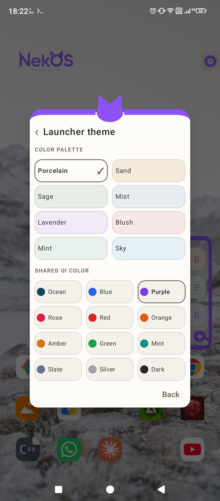

# NekOS 0.7.1

NekOS 0.7.1 focuses on launcher stability, UI refinement, improved app and Tag persistence, and a more modular internal architecture.

> **Development notice:** NekOS is still under active development. This release is not a guarantee of production stability. You may encounter bugs, incomplete behavior, or changes in future versions. Please use it with that in mind and report any issues you find.

## What's new

### Home and App Drawer improvements
- Refined Home and App Drawer component boundaries.
- Improved gesture handling, including preventing reverse scrolling from unintentionally closing the App Drawer.
- Improved return-to-Home navigation behavior.
- Reduced unnecessary Home asset reloads when resuming the launcher.
- Cleared transient app previews when closing the Drawer.

### Wallpaper options
- Added built-in wallpaper choices.
- Added lower-resolution wallpaper previews for more efficient loading.
- Improved selected-wallpaper state handling.
- Avoided unnecessary wallpaper reloads during resume and memory trim.

### Dialog and interface refinement
- Introduced the shared TopFrame artwork system for dialogs and app action menus.
- Added reusable TopFrame rendering, sizing, and shared UI-color support.
- Refined dialog sizing, alignment, spacing, typography, and touch targets.
- Made Settings and Tag dialogs more compact and consistent.
- Improved the long-press app action menu frame.

### Favorite reliability
- Added persisted Favorite app snapshots for faster restoration.
- Improved restoring Favorite icons before the app catalog scan completes.
- Kept persisted Favorite snapshots aligned with current data.
- Improved Favorite gesture reliability and diagnostics in debug builds.
- Added safeguards against overwriting unreadable Favorite data.

### Tag and icon improvements
- Persisted Tag icon bitmaps to disk and bounded the cache size.
- Improved cache validation and bitmap cleanup.
- Reduced concurrent thumbnail decoding.
- Fixed Tag picker thumbnails after memory trim.
- Improved Tag reorder behavior, persistence-failure recovery, and dialog state refresh.
- Added validation and safeguards for malformed or unreadable Tag data.

### App lifecycle and compatibility
- Improved handling of temporarily unavailable, suspended, disabled, replaced, and work-profile apps.
- Persisted package availability markers and restored them across launcher restarts.
- Cleaned up stale package markers when references are removed or profiles become available.
- Kept package observers active while the launcher is stopped.
- Retried failed app catalog scans on resume.
- Improved memory trim handling, including Android 14+.

### Architecture and developer improvements
- Extracted Home, App Drawer, Settings, Tag dialogs, color pickers, and persistence helpers into focused components.
- Reduced responsibilities in the root launcher component.
- Reorganized project asset directories and documentation.
- Added JSON asset catalog validation to CI.
- Expanded automated tests for Favorite, Tag, app lifecycle, and launcher interactions.

## Screenshots

The following screenshots show NekOS 0.7.1:

  
  
  

  
  
  

  
  

## Version information

- **Version name:** 0.7.1
- **Android version code:** 4
- **Application ID:** `com.nekos.android`
- **Minimum Android version:** Android 8.0 (API 26)

## Upgrade notes

Install this version over an existing NekOS installation only when the APK is signed with the same signing key as the installed build. Keep your signing key safe; Android requires the same signing identity for in-place updates.

---

NekOS is an evolving project. Thank you for testing it and helping improve it.

You can also take your part to support me on [Ko-fi](https://ko-fi.com/mazbayid) ☕
