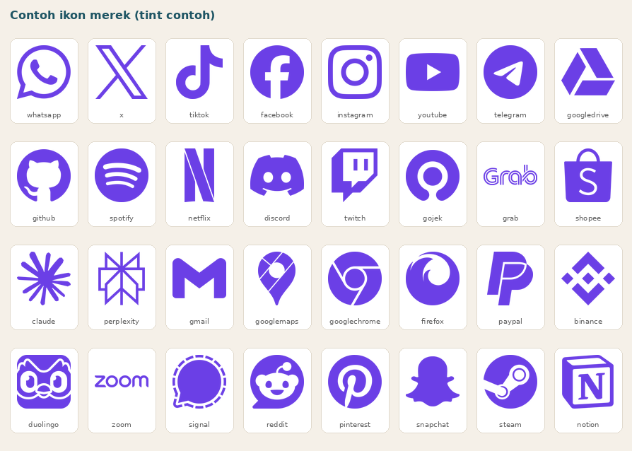

# NekOS Icon Pack · Essentials (v3)

Ikon aplikasi bawaan NekOS: monochrome (mask putih + alpha), bisa di-tint, ringan. Dua lapis:

1. **Ikon merek** bersiluet khas per aplikasi: `icons/brands/` (**3.369 ikon**, 96×96 WebP lossless, ±1,4 KB per ikon, ±4,8 MB total). Sumber: [Simple Icons](https://simpleicons.org), lisensi CC0 (`LICENSES/`).
2. **Glyph kategori** generik: `icons/apps/` (**109 glyph**, gaya NekOS) sebagai cadangan bila aplikasi tidak punya ikon merek.



## Status jujur

| | Jumlah |
|---|---|
| Ikon merek tersedia | 3.369 |
| Aplikasi di peta pasti (`app_icon_map.json`) | 1.418 |
| …yang terhubung ke ikon merek | **362** |
| …sisanya | memakai glyph kategori |

Angka 3.000 **tidak** berarti 3.000 aplikasi Android terpetakan:

- Simple Icons berisi merek apa saja (termasuk situs dan perangkat lunak desktop), bukan hanya aplikasi Android. Dari 1.418 aplikasi di peta, 362 punya padanan ikon merek.
- Set ini **tidak punya** banyak merek penting: Microsoft Office/Teams/Outlook, Amazon, Disney+, Slack, Skype, dan hampir semua aplikasi Indonesia (Tokopedia, Traveloka, DANA, OVO, BCA, dll.). Aplikasi itu jatuh ke glyph kategori. Menggambar logo merek akurat tidak bisa dilakukan secara otomatis.
- Package name di peta ditulis dari pengetahuan umum dan **belum diverifikasi satu per satu** ke Play Store.

## Urutan pencocokan (di launcher)

1. `app_icon_map.json` → `apps[]` exact package: pakai `brand` bila ada, jika tidak `glyph`.
2. Label aplikasi → `brand_index.json` (normalisasi: huruf kecil, `+`→`plus`, `&`→`and`, buang selain a-z0-9; cocokkan ke `slugs` atau `aliases`). Ini menangkap aplikasi tak terdaftar yang labelnya sama dengan merek.
3. `app_icon_rules.json` → `prefix_rules` (awalan terpanjang) lalu `keyword_rules`.
4. `default_glyph` = `paw`.

Aturan (langkah 3) hanya tebakan. Uji internal pada 311 package di luar peta pasti: 123 cocok awalan, 84 cocok kata kunci, 104 jatuh ke `paw`; itu ukuran cakupan, bukan ketepatan.

## Isi

```
icons/brands/<slug>.webp    3.369 ikon merek
icons/apps/icon_<glyph>.webp + icons_index.json/.md   109 glyph kategori
app_icon_map.json           package -> glyph (+ brand)   (schema_version 3)
brand_index.json            daftar slug + alias + aturan normalisasi label
app_icon_rules.json         prefix_rules, keyword_rules
preview_brands.png, preview_glyphs.png
LICENSES/simple-icons-LICENSE.md
tools/map_packages.py       petakan daftar package (brand -> exact -> prefix -> rule)
tools/validate_pack.py      validasi seluruh paket
```

## Cara pakai

- Warna tidak ada di file: tint glyph/ikon merek dengan warna `on_badge` di atas badge ber-tint Shared UI (komposisi sama dengan ikon tag), atau tint `foreground` tanpa badge. Warna `on_badge` otomatis berdasarkan kontras: lihat `nekos_skin_kit` v3 `docs/01 §3.5`.
- Muat peta + `brand_index.json` sekali saat start; decode ikon malas + cache (±36 KB bitmap per ikon).
- Ikon merek sudah dipusatkan dan dinormalkan ke maks 76 px dalam kanvas 96 (live area 80×80), sehingga ukuran optiknya seragam dengan glyph.

## Memperluas

```bash
adb shell pm list packages -3 | sed 's/package://' > packages.txt
python3 tools/map_packages.py packages.txt -o extra_map.json
python3 -I tools/validate_pack.py
```

Hasil bertanda `source`: `exact` (pasti), `prefix`/`rule` (tebakan; tinjau), `default`; `brand` bila ikon merek ditemukan dari label.

## Merek dagang dan lisensi

File SVG Simple Icons berlisensi CC0, tetapi **logo adalah merek dagang pemiliknya**. Memakainya untuk mengidentifikasi aplikasi yang bersangkutan lazim dilakukan, namun pemilik merek bisa punya pedoman penggunaan sendiri. Tinjau (dan bila perlu minta nasihat hukum) sebelum merilis NekOS dengan ikon merek bawaan. Glyph kategori di `icons/apps/` adalah gambar generik milik proyek ini.

## Perubahan dari v2

- Ditambah 3.369 ikon merek, `brand_index.json`, `preview_brands.png`, dan lisensi.
- `app_icon_map.json`: kolom `brand` (362 aplikasi), `schema_version` 3.
- `map_packages.py` dan `validate_pack.py` mendukung ikon merek.
